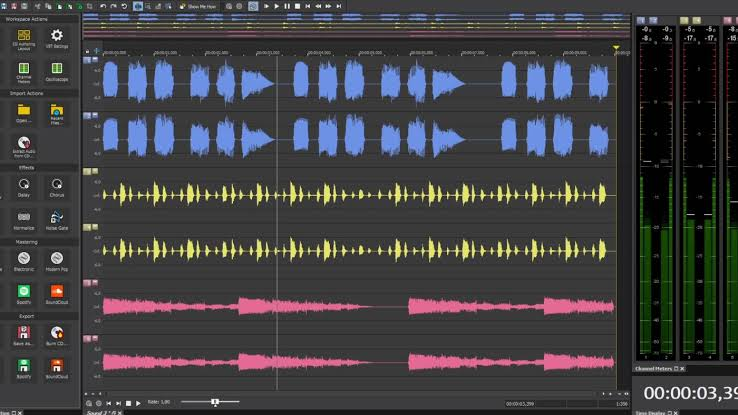

# Sound Forge for Audio Editing and Mastering

Sound Forge provides waveform editing, recording, restoration, and audio preparation tools.
This independent overview focuses on practical editing decisions and delivery checks.
Keep an untouched source recording alongside the edited version.

[](https://sony-forge.github.io/Sound-Forge/)

## Features

Sony Forge is retained here as the requested search phrase associated with the product's history.
Sound Forge is the application name used throughout this guide.
The sound forge audio studio edition should be evaluated against its own feature list.
References to magix sound forge describe an earlier period of product ownership.
The phrase boris fx sound forge reflects the acquisition announced in March 2026.

**Waveform editing**

Editing an audio file starts with deciding what should change and what should remain audible.
Listen to the original before selecting regions for cuts, fades, or processing.
Use the waveform to locate an event, then confirm the selection by listening.

| Task | Editing decision | Review criterion |
| --- | --- | --- |
| Remove an unwanted passage | Selection boundaries and join position | No clipped word or distracting discontinuity |
| Repair a recording | Problem type and processing strength | Reduced disturbance without excessive artifacts |
| Prepare spoken audio | Pauses, level changes, and transitions | Natural pacing and intelligibility |
| Digitize a source | Input device and recording format | Correct channels and usable recording level |
| Process multiple files | Shared settings and destination naming | Consistent output with originals preserved |
| Deliver a finished file | Format, channel count, and sample rate | Match the recipient's specification |

For spoken material, preserve breaths and pauses that contribute to meaning.
A very short edit can change the rhythm of a sentence.
Compare the edited transition with a longer section around it.

**Recording and monitoring**

Confirm the input source before recording a long take.
A meter showing activity does not establish that the intended microphone is selected.
Make a short test recording and replay it through the monitoring path.

- Identify the intended recording device and input channels.
- Check levels while the source reaches its expected loudest passages.
- Listen for hum, intermittent noise, and unwanted room sound.
- Confirm that the recorded channels correspond to the intended inputs.
- Record enough surrounding sound to judge a repair in context.
- Retain the original take before applying a sequence of edits.

The supplied comparison code includes PortMixer materials from Audacity.
Its interface is declared in [portmixer.h](thirdparty/portmixer/include/portmixer.h).
The shared implementation appears in [px_mixer.c](thirdparty/portmixer/src/px_mixer.c).

Windows backend examples include [px_win_wmme.c](thirdparty/portmixer/src/px_win_wmme.c).
Separate files cover [px_win_ds.c](thirdparty/portmixer/src/px_win_ds.c) and [px_win_wasapi.c](thirdparty/portmixer/src/px_win_wasapi.c).
These are reference implementations from another project, not Sound Forge drivers.


**Restoration and processing**

Choose a repair based on the disturbance rather than applying every available effect.
Listen for processing artifacts around consonants, transients, and quiet tails.
An apparently cleaner waveform can still sound less natural.

For a batch job, test the complete processing chain on representative files first.
Include both quiet and loud examples when the source material varies.
Review the beginning, middle, and end of processed results.

**Export inspection**

The following command uses ffprobe, a separate tool distributed with FFmpeg.
It reads the first audio stream and reports technical metadata as JSON.
It does not launch Sound Forge or change the input file.

```bash
ffprobe -v error -select_streams a:0 \
  -show_entries stream=codec_name,sample_rate,channels:format=duration \
  -of json "delivery.wav"
```

Use the result to compare the file with the requested delivery format.
Metadata alone cannot confirm that the edit sounds correct or meets a loudness target.
Listen to the exported file as part of the same review.

## Motivation

A repeatable editing process makes revisions easier to compare.
Separate the original recording, working version, and final delivery in your naming scheme.
Record decisions that another editor would need to reproduce the result.

An edit log can state the source name, removed passage, processing choice, and export requirement.
Describe the reason for a change rather than recording only a tool name.
This helps distinguish an intentional creative choice from a technical repair.

**Listening and measurement**

Compare processed and unprocessed material at a similar perceived level.
A louder result can sound preferable even when an unwanted artifact has been introduced.
Check the quiet portions as well as the most prominent passages.

- Review joins at normal playback speed.
- Check both channels when the material is stereo.
- Listen beyond the selected region to assess the transition.
- Inspect silence added at the start or end.
- Confirm that the recipient receives the intended version.
- Keep notes for changes that may need to be reversed.

This Python example reads an existing uncompressed PCM WAV file using the standard library.
It prints channel count, sample rate, and duration without modifying the file.
The example is independent of Sound Forge and does not use a product API.

```python
import wave

with wave.open("delivery.wav", "rb") as audio:
    channels = audio.getnchannels()
    rate = audio.getframerate()
    duration = audio.getnframes() / rate
    print(f"{channels} channels, {rate} Hz, {duration:.3f} seconds")
```

Use a supported PCM WAV file for this example.
For other containers or codecs, use an inspection tool that supports the source format.
A file's duration and channel count are useful checks alongside listening.



**Product scope**

Sound Forge is primarily relevant here as a waveform editor and recording application.
A multitrack DAW can address broader arrangement and mixing tasks.
Choose the workflow according to whether the job concerns individual files or a larger session.

Current product details are available on the [official Sound Forge page](https://www.vegascreativesoftware.com/sound-forge/).
The [Boris FX announcement](https://blog.borisfx.com/press/boris-fx-acquires-vegas-pro-sound-forge-and-acid-pro) documents the acquisition from MAGIX.
Check the edition and release before relying on a particular restoration tool or bundled plugin.

## Contributing

The local reference snapshot contains parts of Audacity and its third-party dependencies.
It does not contain Sound Forge's proprietary source code.
Contributions to this independent overview should preserve that distinction.

**Platform reference material**

Additional PortMixer implementations illustrate how another audio application separates platform concerns.
The macOS implementation is [px_mac_coreaudio.c](thirdparty/portmixer/src/px_mac_coreaudio.c).
Linux ALSA support appears in [px_linux_alsa.c](thirdparty/portmixer/src/px_linux_alsa.c).
The Unix OSS implementation is [px_unix_oss.c](thirdparty/portmixer/src/px_unix_oss.c).

These files do not establish Sound Forge compatibility with those platforms.
Use the commercial product's requirements when choosing an operating system or audio setup.

**Dependency definitions**

The reference VST3 integration is defined in [CMakeLists.txt](thirdparty/vst3/CMakeLists.txt).
The LV2 dependency definition is another [CMakeLists.txt](thirdparty/lv2sdk/CMakeLists.txt).
The PFFFT build definition is [CMakeLists.txt](thirdparty/pffft/CMakeLists.txt).

These describe Audacity dependencies and must retain their original attribution.
They do not constitute a list of formats or plugins supported by Sound Forge.

**Build and test material**

Configuration presets are recorded in [CMakePresets.json](CMakePresets.json).
The snapshot also includes [SetupConfigure.cmake](SetupConfigure.cmake).
Dependency preparation appears in [SetupDependencies.cmake](buildscripts/cmake/SetupDependencies.cmake).
Build environment configuration is in [SetupBuildEnvironment.cmake](buildscripts/cmake/SetupBuildEnvironment.cmake).

The reference testflow runner is [run_testflow.sh](buildscripts/tools/run_testflow.sh).
This snapshot lacks other files needed for a complete application build and test run.
Its build scripts are supporting materials, not instructions for compiling Sound Forge.

When proposing a correction, identify the product edition and observable behavior.
For an audio problem, describe the source format and the step that introduces the issue.
For a documentation correction, distinguish vendor claims from your own listening observations.

## License

Sound Forge is commercial software distributed under its vendor's terms.
The supplied Audacity and third-party materials retain their respective upstream license requirements.
This overview does not grant a Sound Forge license or redistribution rights to its binaries.
Preserve applicable notices when modifying or sharing the reference files.

## Related Search Terms

Sony Forge, Sound Forge, sound forge audio studio, magix sound forge, boris fx sound forge, audio, audio-editing, editor, recording, waveform, mastering, audio-restoration, vst, digital-audio, audio-processing
